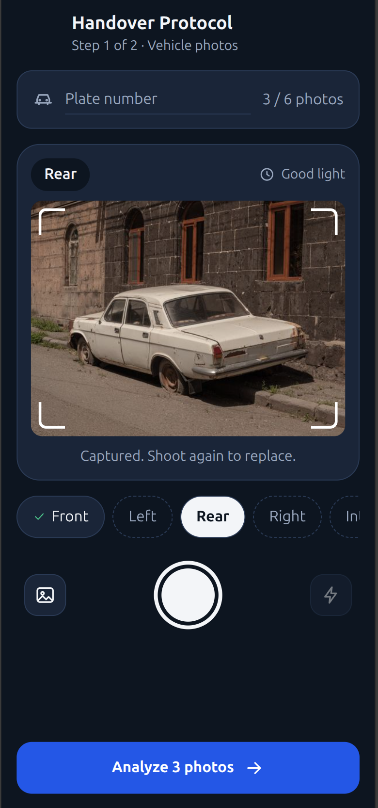
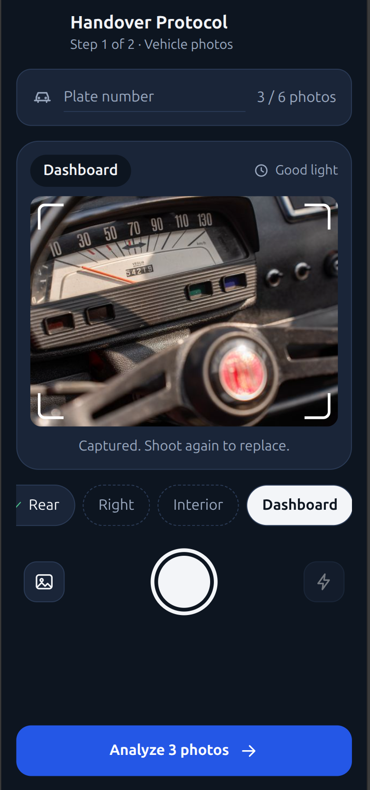
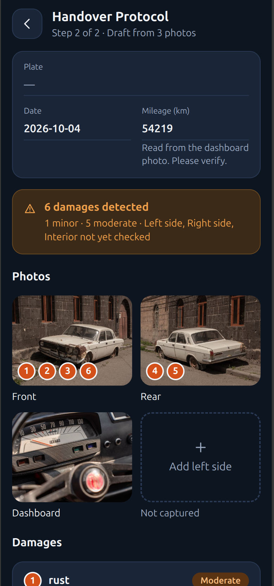
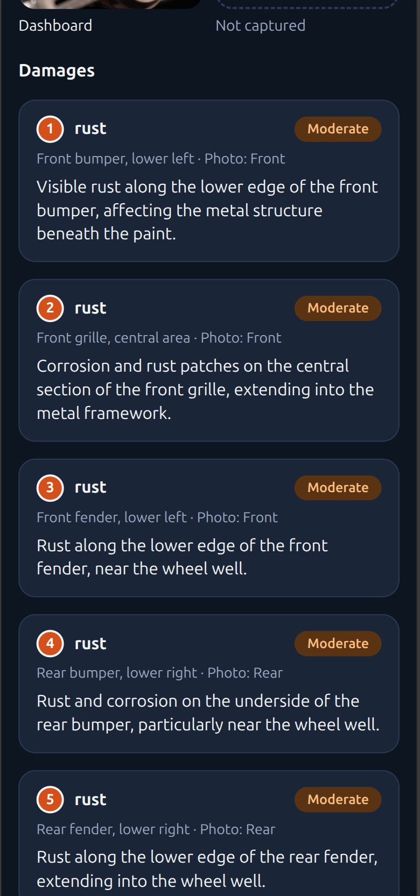
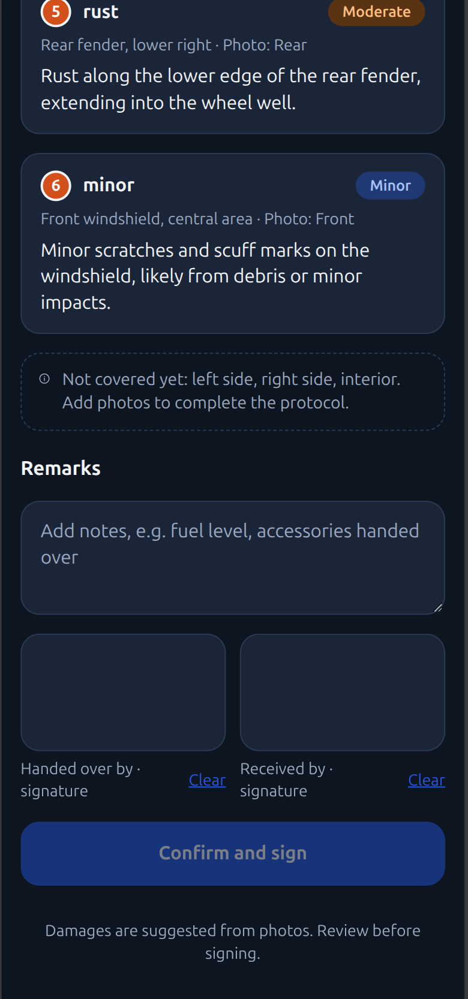

# Handover Protocol

A mobile-first web app that creates a vehicle handover protocol from photos. Take or upload photos of a vehicle, and a vision model suggests the damages and reads the license plate and odometer. You review the draft, add remarks, and sign on screen.

This is an MVP. It is stateless: there is no database, no file storage, and no PDF export.

## How it works

1. **Capture:** take or upload photos for up to six slots: front, left, rear, right, interior, dashboard. You can analyze with any subset.
2. **Analyze:** the React client sends the photos to the Node backend, which resizes them and asks an OpenAI-compatible vision model for damages, the plate, and the odometer.
3. **Review:** the draft protocol shows the vehicle data, a damage summary, numbered damage cards, and which slots are still missing. Add the missing photos and analyze again.
4. **Sign:** add remarks and both signatures. "Confirm and sign" only locks the screen locally.

<p>
  
  
  
  
  
</p>

Everything the model returns is a suggestion. See [AI_DILIGENCE.md](AI_DILIGENCE.md).

## Requirements

- Node.js 20 or newer
- An OpenAI-compatible API with a vision-capable model, and its API key

## Setup

```bash
cd server
cp .env.example .env     # then edit .env
npm install

cd ../client
npm install
```

Configure `server/.env` (contents of `server/.env.example`):

```bash
# OpenAI-compatible API with a vision-capable model
VISION_API_BASE_URL=http://127.0.0.1:8080/v1
VISION_API_KEY=
VISION_MODEL=mistralai/Ministral-3-3B-Instruct-2512-GGUF
PORT=3001
MAX_UPLOAD_MB=10
```

Restart the server after changing `.env`.

## Run

```bash
# terminal 1
cd server && npm run dev      # http://localhost:3001

# terminal 2
cd client && npm run dev      # http://localhost:5173
```

Open http://localhost:5173 in a phone-sized window. The live camera works on `localhost` or HTTPS. Otherwise the shutter falls back to the device's photo picker, and the gallery button always works.

## Test and build

```bash
cd server && npm test && npm run typecheck
cd client && npm test && npm run build
```

Tests use a mocked model and never call a real API.

## Test data

Sample photos for trying the app: [Pexels profile @ibragraphics](https://www.pexels.com/@ibragraphics/). Check the license terms of each photo before reusing it elsewhere.

## API

- `GET /api/health`
- `POST /api/analyze`: multipart/form-data with file fields `front`, `left`, `rear`, `right`, `interior`, `dashboard` (at least one) and optional text fields `plate`, `mileageKm`. Returns the draft protocol as JSON. Errors use `{ "error": { "code", "message" } }`.

Quick check without the client:

```bash
curl -F front=@front.jpg -F dashboard=@dashboard.jpg http://localhost:3001/api/analyze
```

| Status | Meaning |
|---|---|
| 400 | No photos, wrong file type, or unreadable image |
| 413 | A photo exceeds `MAX_UPLOAD_MB` |
| 422 | The model returned unusable output twice |
| 502 / 504 | The model call failed or timed out. Code `upstream_auth` means the key or settings in `.env` are wrong |

## Project layout

```
client/    React + Vite + TypeScript app (state in src/state.ts, UI text in src/copy.ts)
server/    Express + TypeScript API (vision call in src/services/vision.ts)
mockups/   Reference designs (PDF)
```

Contributor and architecture notes are in [CLAUDE.md](CLAUDE.md).

## Limitations

- Damages are not located within the photos, so the badges on photo tiles sit at a fixed spot.
- Damages cannot be edited or deleted yet.
- There is no PDF export, persistence, or authentication.
- Detection quality has not been measured on real photos.

## Thank you

Thank you to [Vera Emilie](https://www.pexels.com/@aloevera/) for sharing the photos [Abandoned Broken Car](https://www.pexels.com/photo/abandoned-broken-car-17296103/) and [Abandoned White Car on Sidewalk](https://www.pexels.com/photo/abandoned-white-car-on-sidewalk-17296098/) on Pexels, which helped us test the damage detection.

Thank you to [Vladimir Srajber](https://www.pexels.com/@vladimirsrajber/) for sharing the photo [A Close-up of a Dashboard with a Speedometer](https://www.pexels.com/photo/a-close-up-of-a-dashboard-with-a-speedometer-28273664/) on Pexels, which helped us test the odometer reading.
